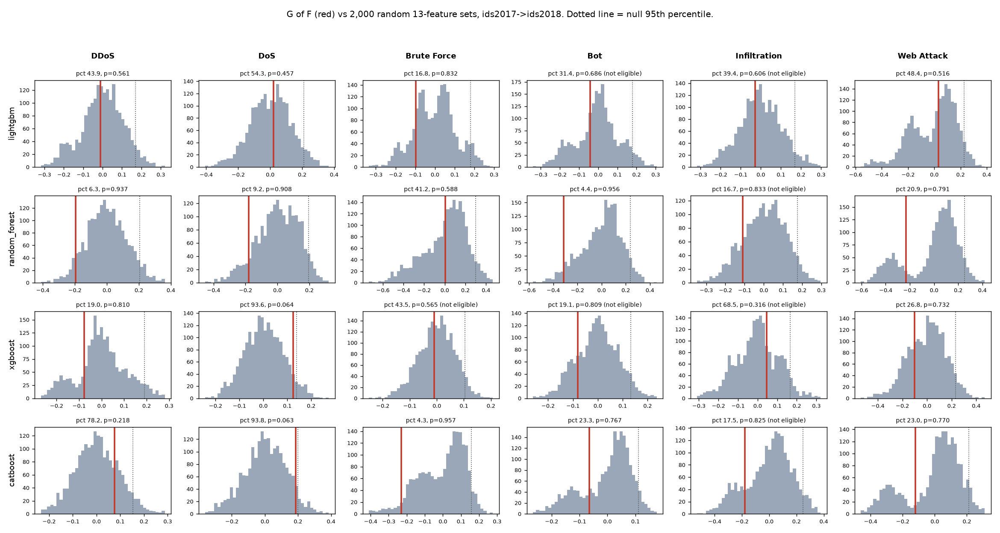
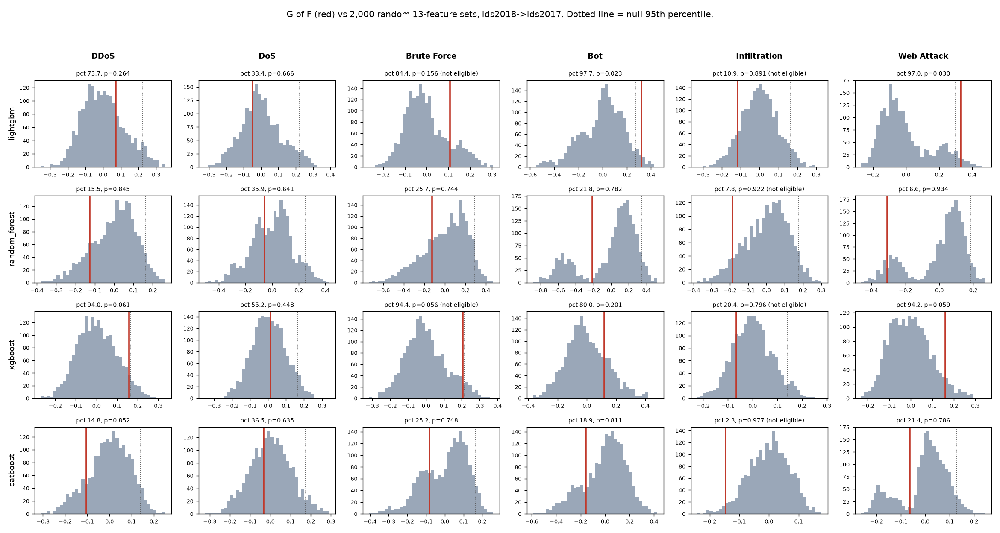

# ผล SHAP รอบ 2-3 แบบแบ่ง 70/30

ฉบับก่อนใช้ผลที่ train 60% (โปรโตคอลเดิมกัน calibration 10% ไว้แต่ไม่เคยใช้) ฉบับนี้รันรอบ 2-3 ใหม่ทั้งหมดบน split 70/30 ด้วยสคริปต์และเกณฑ์เดิม ไม่แก้ F ไม่แก้เกณฑ์ ตัวเลขทุกตัวในเอกสารนี้อ่านจากไฟล์ผลโดยตรง ผลที่ train 60% เทียบไว้ในหัวข้อสุดท้าย

เอกสารนี้เอาผลรอบ 2 (LightGBM) กับรอบ 3 (RF, XGBoost, CatBoost) มาจัดเป็น 4 ส่วน ใช้ค่า SHAP รายแถวที่เก็บไว้ตอนรันจริง แล้วสุ่มกลุ่ม feature 2,000 ชุดใหม่ด้วย seed เดิม ได้ค่า G และ p ตรงกับผลรอบ 2-3 ที่รันใหม่ทุกค่า (สคริปต์หยุดถ้าไม่ตรง)

สคริปต์: `scripts/shap_evidence_pack.py`

ไฟล์ผล: `results/crossdataset/importance_comparison/shap_evidence/`

## สรุป

ทิศ 2017 -> 2018 (ทิศที่ใช้ตัดสิน) มี 17 กรณีที่จำนวนแถวพอ ไม่ผ่านเลยสักกรณี และไม่มีกรณีไหนได้ p < 0.05 ที่ใกล้สุดคือ catboost DoS p = 0.063 และ xgboost DoS p = 0.065 ซึ่งต้องต่ำกว่า 0.010 (CatBoost, 5 class) หรือ 0.017 (XGBoost, 3 class) ถึงจะผ่าน RF ได้ G ติดลบ 4 จาก 5 class (Brute Force ได้ +0.004 ซึ่งใกล้ศูนย์)

ทิศ 2018 -> 2017 มี 2 กรณีที่ p < 0.05 คือ lightgbm Bot (G = +0.320, p = 0.024), lightgbm Web Attack (G = +0.331, p = 0.030) แต่ไม่ผ่าน Bonferroni (0.05 / 4 = 0.0125) และ random_forest, catboost ในทิศนี้ได้ G ติดลบทุก class

กลุ่ม feature สุ่ม 13 ตัวก็ได้ G กว้างพอสมควร (95th percentile อยู่ราว 0.11 ถึง 0.35) แปลว่าแถวที่ทายพลาดกับแถวที่ทายถูกต่างกันหลาย feature ไม่ได้ต่างแค่ที่กลุ่ม F

ผมจึงสรุปว่าการทายพลาดตอนข้าม dataset ไม่น่าเกิดจากกลุ่ม fingerprint กลุ่มเดียว น่าจะมาจากหลาย feature ที่ความสัมพันธ์กับ class เปลี่ยนไปเมื่อย้าย dataset ผลนี้เข้ากับคำอธิบายนี้ แต่ยังไม่ได้ทดสอบตรงๆ

ข้อสรุปเหมือนฉบับ 60% ที่เปลี่ยนคือจำนวนกรณีที่นับได้ (จาก 13 เป็น 17 ในทิศตัดสิน) เพราะ SSH-Patator ของ 2017 เข้ามาอยู่ใน train ทำให้โมเดลทาย Brute Force ใน 2018 ถูกบางส่วนและมีแถว caught ให้เทียบได้

## 1. รายชื่อ feature ในกลุ่ม dataset-specific (F)

F มี 13 ตัว เลือกจาก 60 feature (77 column รวม column ที่ซ้ำกันแล้วเหลือ 60) โดยใช้โมเดล adversarial คือ LightGBM ที่เทรนให้ทายว่าแถวมาจาก 2017 หรือ 2018 แล้ววัดความสำคัญของ feature 2 วิธี การเลือก F ไม่ได้ใช้ split 60/10/30 หรือ 70/30 ของโปรโตคอล (ใช้การแบ่งสุ่ม 70/30 ภายในของงาน adversarial) F จึงเป็นชุดเดิมทุกตัว

- permutation importance: นับว่าผ่านถ้าค่าเฉลี่ยเป็นบวกและมากกว่า 2 เท่าของ SD ระหว่าง seed ได้ 18 ตัว
- SHAP: นับว่าผ่านถ้า share ไม่ต่ำกว่า 1/60 ทั้งค่าเฉลี่ยและใน 4 จาก 5 seed ได้ 26 ตัว

F คือ feature ที่ผ่านทั้งสองวิธี ได้ 13 ตัว ใช้ชุดนี้ตัดสินตั้งแต่รอบ 2

| feature | permutation (adversarial) | AUC ตัวเดียว | SHAP share สูงสุด |
|---|---|---|---|
| min_seg_size_forward | 0.04821 | 0.685 | 0.731 |
| RST Flag Count | 0.04133 | 0.693 | 0.698 |
| Init_Win_bytes_forward | 0.00580 | 0.716 | 0.194 |
| Destination Port | 0.00077 | 0.594 | 0.068 |
| Max Packet Length | 0.00026 | 0.805 | 0.063 |
| act_data_pkt_fwd | 0.00020 | 0.766 | 0.471 |
| Fwd IAT Min | 0.00014 | 0.706 | 0.046 |
| Init_Win_bytes_backward | 0.00010 | 0.766 | 0.300 |
| Flow IAT Min | 0.00010 | 0.694 | 0.042 |
| Bwd IAT Min | 0.00006 | 0.675 | 0.028 |
| Min Packet Length | 0.00006 | 0.605 | 0.059 |
| Bwd Packet Length Min | 0.00004 | 0.580 | 0.051 |
| Bwd Packet Length Std | 0.00000 | 0.763 | 0.052 |

AUC ตัวเดียว คือ AUC ตอนใช้ feature นั้นตัวเดียวแยก 2017 กับ 2018 ส่วน SHAP share สูงสุด คือ share ที่สูงสุดในบรรดา class ทั้งหมด ค่า permutation ของหลายตัวเล็กมาก เพราะ feature ที่คล้ายกันแบ่งข้อมูลกันไป (เจอแล้วในรอบ 1) แต่ยังผ่านเกณฑ์ 2 SD ได้เพราะค่าแต่ละ seed ใกล้กัน

ไฟล์: `feature_group.csv` (มีครบ 60 ตัว ดูคอลัมน์ `in_F`)

## 2. ค่า SHAP ของแต่ละโมเดลและแต่ละรอบ (seed)

ทุกโมเดลตั้งค่าเหมือนกัน ใช้ split แบบ chronological 70/30 และ seed 42-46

- missed คือ attack ใน test ของ dataset ปลายทางที่โมเดลทายเป็น Benign
- caught คือ attack ใน test ของ dataset ต้นทางที่โมเดลทายถูก
- ใช้ไม่เกิน 1,000 แถวต่อ class ต่อกลุ่มต่อ seed
- ดูเฉพาะ SHAP ของ output Benign ที่เป็นบวก
- s คือสัดส่วนของ SHAP บวกที่มาจาก F เฉลี่ยทุกแถว
- gap = s(missed) - s(caught) ของแต่ละ seed และ G คือค่าเฉลี่ย gap ของ 5 seed
- นับเฉพาะ class ที่มี missed อย่างน้อย 100 แถว และ caught อย่างน้อย 30 แถว ทุก seed

ถ้า F เป็นตัวที่ทำให้ทายเป็น Benign จริง gap ควรเป็นบวกทุก seed

### ทิศ 2017 -> 2018 (ใช้ตัดสิน)

| model | class | seed 42 | 43 | 44 | 45 | 46 | G | s(missed) | s(caught) |
|---|---|---|---|---|---|---|---|---|---|
| lightgbm | DDoS | -0.040 | -0.047 | -0.004 | +0.025 | +0.007 | -0.012 | 0.475 | 0.487 |
| lightgbm | DoS | +0.035 | -0.001 | +0.019 | +0.069 | -0.012 | +0.022 | 0.369 | 0.347 |
| lightgbm | Brute Force | -0.111 | -0.112 | -0.133 | -0.088 | -0.038 | -0.097 | 0.208 | 0.304 |
| lightgbm | Web Attack | +0.004 | +0.067 | +0.034 | +0.034 | +0.014 | +0.031 | 0.476 | 0.445 |
| random_forest | DDoS | -0.235 | -0.227 | -0.163 | -0.184 | -0.159 | -0.194 | 0.247 | 0.441 |
| random_forest | DoS | -0.162 | -0.138 | -0.199 | -0.244 | -0.155 | -0.180 | 0.182 | 0.362 |
| random_forest | Brute Force | -0.247 | +0.036 | +0.113 | +0.043 | +0.076 | +0.004 | 0.093 | 0.088 |
| random_forest | Bot | -0.350 | -0.148 | -0.342 | -0.393 | -0.337 | -0.314 | 0.215 | 0.529 |
| random_forest | Web Attack | -0.299 | -0.173 | -0.219 | -0.298 | -0.177 | -0.233 | 0.305 | 0.538 |
| xgboost | DDoS | -0.076 | -0.120 | -0.070 | -0.098 | -0.024 | -0.078 | 0.540 | 0.618 |
| xgboost | DoS | +0.122 | +0.152 | +0.103 | +0.092 | +0.157 | +0.125 | 0.546 | 0.421 |
| xgboost | Web Attack | -0.040 | -0.065 | -0.159 | -0.100 | -0.133 | -0.100 | 0.495 | 0.595 |
| catboost | DDoS | +0.070 | -0.038 | +0.076 | +0.173 | +0.095 | +0.075 | 0.586 | 0.510 |
| catboost | DoS | +0.202 | +0.122 | +0.223 | +0.167 | +0.227 | +0.188 | 0.478 | 0.290 |
| catboost | Brute Force | -0.212 | -0.123 | -0.227 | -0.298 | -0.290 | -0.230 | 0.233 | 0.464 |
| catboost | Bot | -0.080 | +0.017 | -0.075 | -0.086 | -0.100 | -0.065 | 0.374 | 0.439 |
| catboost | Web Attack | -0.004 | -0.186 | -0.115 | -0.113 | -0.184 | -0.120 | 0.564 | 0.685 |

s(missed) และ s(caught) ในตารางเป็นค่าเฉลี่ย 5 seed

Infiltration นับไม่ได้ในทุกโมเดล (caught ไม่ถึง 30 แถว) Bot นับได้เฉพาะ RF กับ CatBoost และ Brute Force นับได้ใน LightGBM, RF, CatBoost ส่วน XGBoost ยังไม่ถึงเกณฑ์ ที่ Brute Force นับได้เพราะการแบ่ง 70/30 ทำให้ SSH-Patator ของ 2017 มี 474 แถวอยู่ใน train (ที่ train 60% มี 0 แถว) โมเดลจึงทาย Brute Force ใน 2018 ถูกบางส่วน ค่าทุก class อยู่ในไฟล์

DoS: gap เป็นบวกทุก seed ใน xgboost, catboost และเป็นลบทุก seed ใน random_forest ส่วน class อื่นแต่ละโมเดลได้เครื่องหมายไม่เหมือนกัน

### ทิศ 2018 -> 2017 (รายงานอย่างเดียว)

| model | class | seed 42 | 43 | 44 | 45 | 46 | G | s(missed) | s(caught) |
|---|---|---|---|---|---|---|---|---|---|
| lightgbm | DDoS | +0.025 | +0.079 | +0.095 | +0.121 | +0.036 | +0.071 | 0.294 | 0.223 |
| lightgbm | DoS | -0.042 | -0.054 | -0.053 | -0.067 | -0.022 | -0.048 | 0.317 | 0.364 |
| lightgbm | Bot | +0.409 | +0.315 | +0.400 | +0.238 | +0.240 | +0.320 | 0.447 | 0.126 |
| lightgbm | Web Attack | +0.343 | +0.411 | +0.352 | +0.242 | +0.306 | +0.331 | 0.625 | 0.295 |
| random_forest | DDoS | -0.165 | -0.106 | -0.120 | -0.100 | -0.141 | -0.126 | 0.405 | 0.532 |
| random_forest | DoS | -0.083 | -0.048 | -0.074 | +0.014 | -0.096 | -0.057 | 0.464 | 0.522 |
| random_forest | Brute Force | +0.044 | -0.223 | -0.150 | -0.141 | -0.159 | -0.126 | 0.108 | 0.234 |
| random_forest | Bot | -0.039 | -0.227 | -0.142 | -0.475 | -0.194 | -0.215 | 0.454 | 0.669 |
| random_forest | Web Attack | -0.334 | -0.276 | -0.337 | -0.315 | -0.274 | -0.307 | 0.265 | 0.572 |
| xgboost | DDoS | +0.139 | +0.165 | +0.162 | +0.179 | +0.150 | +0.159 | 0.404 | 0.245 |
| xgboost | DoS | +0.044 | -0.029 | +0.100 | +0.038 | -0.080 | +0.015 | 0.411 | 0.397 |
| xgboost | Bot | +0.091 | +0.171 | +0.099 | -0.002 | +0.242 | +0.120 | 0.511 | 0.391 |
| xgboost | Web Attack | +0.189 | +0.194 | +0.244 | +0.084 | +0.087 | +0.160 | 0.424 | 0.264 |
| catboost | DDoS | -0.042 | -0.135 | -0.113 | -0.116 | -0.115 | -0.104 | 0.409 | 0.513 |
| catboost | DoS | -0.021 | -0.027 | -0.028 | -0.027 | -0.065 | -0.034 | 0.312 | 0.345 |
| catboost | Brute Force | -0.099 | +0.051 | -0.131 | -0.131 | -0.098 | -0.082 | 0.222 | 0.304 |
| catboost | Bot | -0.131 | -0.175 | -0.310 | +0.142 | -0.309 | -0.157 | 0.406 | 0.563 |
| catboost | Web Attack | -0.134 | -0.074 | -0.030 | -0.051 | -0.030 | -0.064 | 0.404 | 0.468 |

ทิศนี้ random_forest, catboost ได้ gap ติดลบเกือบทุกช่อง ส่วน LightGBM กับ XGBoost มี G เป็นบวกใน class ส่วนใหญ่

ไฟล์: `per_seed_stats.csv` (ทุกโมเดล ทุก class ทุก seed ทั้งสองทิศ มีจำนวนแถว missed ทั้งหมด จำนวนแถวที่ใช้คำนวณ และค่าเฉลี่ยของ SHAP บวกไป Benign ด้วย)

## 3. วิธีสร้างกลุ่ม feature สุ่ม 2,000 ชุด

สุ่มจาก 60 feature ชุดเดียวกับที่ใช้เลือก F ชุดละ 13 ตัวเท่ากับ F ในชุดเดียวกันไม่ซ้ำกัน (`rng.choice(60, size=13, replace=False)`) ใช้ `numpy.random.default_rng(2026)` สุ่มไปจนครบ 2,000 ชุด ทุกโมเดลเริ่มจาก seed เดียวกัน จึงได้ 2,000 ชุดเดียวกัน (และเป็นชุดเดียวกับฉบับ 60% เพราะ seed เหมือนกัน)

แต่ละชุดคำนวณ G แบบเดียวกับ F ทุกขั้น คือคิดทั้ง 5 seed แล้วเฉลี่ย ได้เป็น G_null 2,000 ค่า แล้วคิด p ด้านเดียวจาก

    p = (1 + จำนวน G_null ที่ >= G) / (1 + 2000)

ตอนสุ่มไม่ได้เอา F ออก ชุดสุ่มจึงมี feature ของ F ปนอยู่ได้ เฉลี่ย 2.83 ตัวต่อชุด (0 ถึง 7 ตัว) ผมเช็กด้วยว่าแต่ละ feature ถูกสุ่มได้ใกล้เคียงกัน ควรได้ประมาณ 433 ครั้ง ได้จริง 390 ถึง 478 ครั้ง

ไฟล์: `random_sets.csv` (รายชื่อ feature ของทั้ง 2,000 ชุด และจำนวนที่ซ้ำกับ F), `random_set_feature_counts.csv` (แต่ละ feature ถูกสุ่มกี่ครั้ง)

## 4. ตำแหน่งของผลจริงเทียบกับ 2,000 กลุ่มสุ่ม

percentile คือร้อยละของกลุ่มสุ่มที่ได้ G ต่ำกว่า F ถ้า F มีผลจริง ค่านี้ควรสูงประมาณ 98 ถึง 99 ขึ้นไป (ขึ้นกับจำนวน class ที่ใช้หาร Bonferroni)

เกณฑ์ที่เขียนไว้ก่อนรัน: ผ่านถ้า G > 0 และ p < 0.05 / จำนวน class ที่นับ ถ้า p >= 0.05 ถือว่าไม่สนับสนุน

### ทิศ 2017 -> 2018 (ใช้ตัดสิน)

| model | class | G | null mean | null p95 | percentile | p | ผล |
|---|---|---|---|---|---|---|---|
| lightgbm | DDoS | -0.012 | -0.001 | 0.169 | 43.9 | 0.561 | ไม่สนับสนุน |
| lightgbm | DoS | +0.022 | +0.003 | 0.211 | 54.3 | 0.457 | ไม่สนับสนุน |
| lightgbm | Brute Force | -0.097 | -0.002 | 0.181 | 16.8 | 0.832 | ไม่สนับสนุน |
| lightgbm | Web Attack | +0.031 | -0.004 | 0.228 | 48.4 | 0.516 | ไม่สนับสนุน |
| random_forest | DDoS | -0.194 | -0.001 | 0.206 | 6.3 | 0.937 | ไม่สนับสนุน |
| random_forest | DoS | -0.180 | +0.002 | 0.195 | 9.2 | 0.907 | ไม่สนับสนุน |
| random_forest | Brute Force | +0.004 | +0.007 | 0.302 | 41.2 | 0.588 | ไม่สนับสนุน |
| random_forest | Bot | -0.314 | -0.001 | 0.240 | 4.4 | 0.956 | ไม่สนับสนุน |
| random_forest | Web Attack | -0.233 | -0.007 | 0.252 | 20.9 | 0.791 | ไม่สนับสนุน |
| xgboost | DDoS | -0.078 | +0.001 | 0.191 | 19.0 | 0.810 | ไม่สนับสนุน |
| xgboost | DoS | +0.125 | +0.003 | 0.139 | 93.6 | 0.065 | ไม่สนับสนุน |
| xgboost | Web Attack | -0.100 | -0.001 | 0.234 | 26.8 | 0.732 | ไม่สนับสนุน |
| catboost | DDoS | +0.075 | +0.003 | 0.154 | 78.2 | 0.218 | ไม่สนับสนุน |
| catboost | DoS | +0.188 | +0.003 | 0.199 | 93.8 | 0.063 | ไม่สนับสนุน |
| catboost | Brute Force | -0.230 | -0.004 | 0.158 | 4.3 | 0.957 | ไม่สนับสนุน |
| catboost | Bot | -0.065 | -0.002 | 0.111 | 23.3 | 0.767 | ไม่สนับสนุน |
| catboost | Web Attack | -0.120 | -0.005 | 0.212 | 23.0 | 0.770 | ไม่สนับสนุน |

ไม่มีกรณีไหนเกิน null p95 (percentile สูงสุด 93.8) และ RF อยู่ต่ำกว่า percentile 41 ทุก class

### ทิศ 2018 -> 2017 (รายงานอย่างเดียว)

| model | class | G | null mean | null p95 | percentile | p |
|---|---|---|---|---|---|---|
| lightgbm | DDoS | +0.071 | +0.003 | 0.224 | 73.7 | 0.264 |
| lightgbm | DoS | -0.048 | +0.003 | 0.221 | 33.4 | 0.666 |
| lightgbm | Bot | +0.320 | +0.002 | 0.274 | 97.7 | 0.024 |
| lightgbm | Web Attack | +0.331 | -0.003 | 0.298 | 97.0 | 0.030 |
| random_forest | DDoS | -0.126 | -0.001 | 0.164 | 15.5 | 0.845 |
| random_forest | DoS | -0.057 | -0.001 | 0.249 | 35.9 | 0.641 |
| random_forest | Brute Force | -0.126 | +0.007 | 0.290 | 25.6 | 0.744 |
| random_forest | Bot | -0.215 | -0.000 | 0.350 | 21.8 | 0.782 |
| random_forest | Web Attack | -0.307 | -0.001 | 0.180 | 6.6 | 0.934 |
| xgboost | DDoS | +0.159 | +0.004 | 0.166 | 94.0 | 0.061 |
| xgboost | DoS | +0.015 | +0.005 | 0.164 | 55.2 | 0.448 |
| xgboost | Bot | +0.120 | +0.000 | 0.253 | 80.0 | 0.201 |
| xgboost | Web Attack | +0.160 | -0.003 | 0.168 | 94.2 | 0.059 |
| catboost | DDoS | -0.104 | -0.002 | 0.140 | 14.8 | 0.852 |
| catboost | DoS | -0.034 | +0.001 | 0.172 | 36.5 | 0.635 |
| catboost | Brute Force | -0.082 | +0.005 | 0.164 | 25.2 | 0.748 |
| catboost | Bot | -0.157 | +0.000 | 0.246 | 18.9 | 0.811 |
| catboost | Web Attack | -0.064 | -0.002 | 0.128 | 21.4 | 0.786 |

มี 2 กรณีที่ p < 0.05 คือ lightgbm Bot (G = +0.320, p = 0.024), lightgbm Web Attack (G = +0.331, p = 0.030) แต่ยังสูงกว่าเกณฑ์ Bonferroni (0.05 / 4 = 0.0125) ส่วน RF กับ CatBoost อยู่ต่ำกว่าค่ากลางของ null เกือบทั้งหมด ทิศนี้ไม่ได้ใช้ตัดสินตั้งแต่แรก

### รูป

แต่ละช่องคือโมเดล 1 ตัวกับ class 1 class แท่งสีเทาคือ histogram ของ G จากกลุ่มสุ่ม 2,000 ชุด เส้นแดงคือ G ของ F เส้นประคือ 95th percentile ของกลุ่มสุ่ม หัวช่องเขียน percentile กับ p ช่องที่เขียนว่า no caught rows คือไม่มีแถว caught ให้คำนวณ

ไฟล์: `null_position.csv` (ตารางด้านบน มี SD, z และ percentile 5/25/50/75/99 เพิ่ม), `null_distribution.csv` (G_null ครบ 2,000 ค่าของทุกโมเดล ทุก class ทั้งสองทิศ)

## สรุปและข้อจำกัด

ทั้ง 4 โมเดลไม่มีหลักฐานว่า F ทำให้ attack ถูกทายเป็น Benign ตอนข้าม dataset ค่า G ของ F อยู่ในช่วงเดียวกับกลุ่มสุ่ม และแต่ละโมเดลได้เครื่องหมายไม่ตรงกัน กลุ่มสุ่มเองก็ได้ G กว้าง แสดงว่า SHAP ที่ดันไปทาง Benign ในแถวที่ทายพลาดกระจายอยู่หลาย feature

ข้อจำกัดคืองานนี้ทดสอบแค่ F กลุ่มเดียว จึงตัดคำอธิบายว่าเกิดจาก fingerprint กลุ่มเดียวออกได้ แต่ยังไม่ได้ทดสอบโดยตรงว่าความสัมพันธ์ระหว่าง feature กับ decision boundary เปลี่ยนไป และใช้แค่ tree model ไม่มี MLP กับ LR

ผลรอบ 1-3 เก็บไว้ตามที่ได้ ไม่ได้แก้ F หรือเกณฑ์

## เทียบกับฉบับ train 60%

| รายการ | train 60% | train 70% (ฉบับนี้) |
|---|---|---|
| กรณีที่นับได้ ทิศ 2017 -> 2018 | 13 | 17 |
| กรณีที่ผ่านเกณฑ์ | 0 | 0 |
| p ต่ำสุดในทิศตัดสิน | 0.064 (CatBoost DoS) | 0.063 (catboost DoS) |
| กรณี p < 0.05 ทิศ 2018 -> 2017 | 3 (ไม่ผ่าน Bonferroni) | 2 (ไม่ผ่าน Bonferroni) |
| Brute Force ทิศ 2017 -> 2018 | ไม่มีแถว caught นับไม่ได้ | นับได้ใน LightGBM, RF, CatBoost ไม่สนับสนุนทั้งหมด |

ข้อสรุปไม่เปลี่ยน ส่วนที่เปลี่ยนเกิดจากการที่ SSH-Patator เข้ามาอยู่ใน train ของ 2017 ไม่ได้เกิดจากโมเดลหรือเกณฑ์

## ไฟล์ที่เกี่ยวข้อง

- เกณฑ์ที่เขียนก่อนรัน: `results/crossdataset/importance_comparison/SHAP_ROUND2_PREREGISTRATION.md`, `SHAP_ROUND3_PREREGISTRATION.md`
- ผลที่ใช้: `shap_round2/null_test.csv`, `shap_round3/null_test.csv`
- รายงานเต็มรอบ 1-3: `docs/experiments/crossdataset/round5_shap/report/shap_progress.md`
